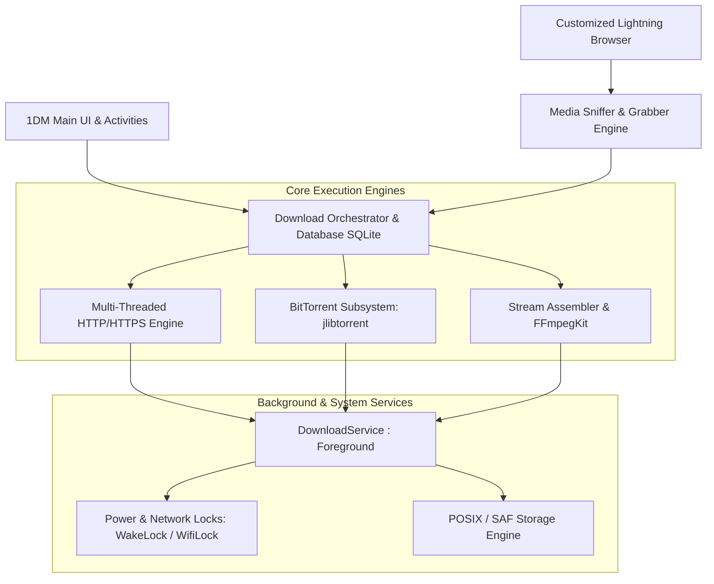

# 1DM v20.0 (Premium) — Reverse Engineering Analysis (REA) & Architectural Specification

> **Document Type:** Reverse Engineering Analysis (REA) Report & Implementation Blueprint  
> **Target Artifact:** `1DM v20.0 (Premium).apk` (`idm.internet.download.manager.plus`)  
> **Binary Metadata:** SHA-256: `352830b17b92e818c6b83a95ce0b04a8af0afe89359eee3370d198e6a08e71f6`  
> **Decompiled Scope:** 17,836 classes across 4 DEX files, native binaries (`libjlibtorrent.so`, `libffmpegkit.so`, `libarchSupport.so`), SQLite database schemas, and 300+ KB of injected browser/sniffer JavaScript scripts.  
> **Target App Comparison:** DMX / XDM (Flutter codebase in `d:\Courses\Projectss\dmx`).

---

## Executive Summary & System Decomposition

1DM (formerly IDM+ / Internet Download Manager for Android) is widely regarded as the most advanced, resilient, and complete mobile download manager. Through binary inspection, DEX decompilation, manifest auditing, and database schema recovery, this document breaks down the core architecture of 1DM v20.0 into five interconnected subsystems:



---

## 1. Direct Download Engine (HTTP / HTTPS / Multi-Part)

### 1.1 Architecture & Core Components
- **Primary Service:** `idm.internet.download.manager.DownloadService`
- **Controller & Worker:** `idm.internet.download.manager.Downloader`
- **Data Model:** `com.aspsine.multithreaddownload.DownloadInfo`, `ThreadInfo`
- **POSIX Layer:** `com.aspsine.multithreaddownload.util.PosixCalls`

### 1.2 Multi-Segment Chunking & Dynamic Part Splitting
1DM does not merely divide a file into equal parts at start time; it uses an adaptive dynamic work-stealing algorithm:
1. **Initial Probing:**
   - Issues a `HEAD` request (or `GET` with `Range: bytes=0-0` or `bytes=1-1`) to determine:
     - `Content-Length` (total file size)
     - `Accept-Ranges: bytes` support
     - `ETag` and `Last-Modified` headers
     - `Content-Type` and `Content-Disposition` (final decoded filename)
2. **Fixed vs Dynamic Part Strategy:**
   - **Fixed Mode:** Divides total length $L$ into $N$ parts (user configurable up to 32 or 64 parts in 1DM+). Each thread is assigned a byte window:
     $$\text{Part}_i = \left[ i \cdot \frac{L}{N}, \; (i+1) \cdot \frac{L}{N} - 1 \right]$$
   - **Dynamic Work-Stealing Splitting:** When an active thread completes its assigned range early, but other parts are still downloading slowly, 1DM dynamically splits the remaining unread range of the slowest active thread:
     $$\text{Remaining} = \text{End}_k - \text{CurrentPosition}_k$$
     If $\text{Remaining} > \text{MinSplitThreshold}$ (typically 1–2 MB), the thread divides the remaining range into two and launches a new worker thread.
3. **Part Tracking (`use_uuid4_parts`):**
   - Historically parts were named `filename.part0`, `part1`.
   - In v20.0, 1DM uses UUID-backed temporary part identification (`use_uuid4_parts = 1`) stored in SQLite `threads` table:
     ```sql
     CREATE TABLE threads (
         _id INTEGER PRIMARY KEY AUTOINCREMENT,
         id INTEGER,
         tag TEXT,
         start LONG,
         end LONG,
         finished LONG,
         length LONG,
         uri TEXT,
         uri_resoluted TEXT,
         position LONG,
         m3u8key TEXT,
         m3u8iv TEXT,
         split_file_type INTEGER DEFAULT 0,
         has_byte_range INTEGER DEFAULT 0,
         content_encoding TEXT,
         m3u8_thread_type INTEGER DEFAULT 0,
         m3u8_raw_url TEXT,
         UNIQUE (id, tag)
     );
     ```

### 1.3 Pause, Resume, and Database Checkpointing
- **Atomic Progress Recording:** Every thread updates its `finished` and `position` in the `threads` table every 1000ms or after every $64\text{ KB}$ written.
- **Validation on Resume:**
  - Before resuming, 1DM sends `If-Range: <ETag>` or `If-Unmodified-Since: <Last-Modified>`.
  - If the server responds with `HTTP 206 Partial Content`, resume proceeds safely.
  - If the server responds with `HTTP 200 OK`, 1DM detects that the file was modified on server or does not support byte ranges, immediately cancels multi-threading, truncates the file, and switches to single-stream download (`advance_download_method = 0`).
  - **Link Refresh Mechanism:** For temporary/expiring download links (e.g. Mega, Google Drive, Rapidgator), 1DM supports "Refresh Download Link", updating `uri` and `cookies` while retaining downloaded byte parts in `threads`.

### 1.4 Speed Limiting & Socket Buffer Optimization
- **Token Bucket Limiter:** Implemented per-download (`speedlimit`) and globally (`idm_pref_speed_limiter`).
- **Socket Buffer Tuning:**
  - `max_http_recv_buffer_size`: 32 KB – 256 KB dynamically scaled depending on active connection bandwidth.
  - `recv_socket_buffer_size` and `send_socket_buffer_size`: Set explicitly on `Socket` via `setReceiveBufferSize()`.
- **Domain Concurrency Limiter:**
  - `DomainPartLimitActivity` backed by `domain_part_limit` table: limits concurrent connections per domain/IP to prevent servers (Cloudflare, Akamai) from triggering HTTP 429 (Too Many Requests) or IP bans.

### 1.5 Storage Access Framework (SAF) vs POSIX Preallocation
- In modern Android (API 29–34+), 1DM supports both direct POSIX filesystem writes (`PosixCalls`) and SAF `DocumentFile` URIs (`usesaf = 1`).
- For POSIX storage, 1DM uses `fallocate` or sparse allocation to reserve disk space up front, preventing filesystem fragmentation and out-of-space crashes mid-transfer.

---

## 2. BitTorrent / P2P Subsystem

### 2.1 Engine Architecture
1DM does not use Java-based torrent implementations; it incorporates **FrostWire's `jlibtorrent`** (Java JNI wrappers around Arvid Norberg's native C++ `libtorrent` 1.2/2.0):
- **Native Binary:** `lib/arm64-v8a/libjlibtorrent.so` (and armeabi-v7a).
- **Core Controller:** `com.frostwire.jlibtorrent.SessionManager`, `TorrentHandle`.
- **UI & Configuration:** `idm.internet.download.manager.TorrentDetails`, `IDMSettingsActivity$TorrentPreferenceFragment`.

### 2.2 BitTorrent Data Model in SQLite
Torrent downloads are first-class citizens in the `downloads` table:
```sql
is_torrent INTEGER DEFAULT 0,
is_sequential INTEGER DEFAULT 0,
file_priorities TEXT,           -- Array of per-file download priorities (0=skip, 1=low, 4=normal, 7=high)
file_progress TEXT,             -- Per-file bytes completed
new_trackers TEXT,              -- Semicolon-delimited extra tracker list
torrent_down_limit INTEGER,     -- In bytes/sec
torrent_up_limit INTEGER,       -- In bytes/sec
torrent_seeders INTEGER,        -- Live active seeders
torrent_leechers INTEGER,       -- Live active peers
torrent_finished LONG,          -- Timestamp of completion
new_torrent INTEGER DEFAULT 1,
info_hash TEXT                  -- 40-char SHA-1 or 64-char SHA-256 info hash
```

### 2.3 Key Torrent Features
1. **Magnet Link Resolution:**
   - Parses `magnet:?xt=urn:btih:...`.
   - Starts an async metadata discovery phase (`Fetch metadata from magnet link before adding/starting download`).
   - Downloads torrent info dictionary from DHT/Peers into RAM before writing files to disk.
2. **Selective File Downloading (`Torrent$FolderSelection`):**
   - Presents a file/folder tree view where users can uncheck individual files or set priorities.
   - Files marked priority `0` are ignored by libtorrent's piece picker.
3. **Sequential Download (`is_sequential = 1`):**
   - Forces libtorrent to request pieces in strictly ascending order ($0, 1, 2, \dots$) rather than rarest-first.
   - Prioritizes head and tail pieces first so that media players can read container headers (moov atom / index) immediately for instant streaming during download.
4. **P2P Networking & Privacy:**
   - **DHT (Distributed Hash Table):** Kademlia mainline DHT enabled.
   - **PeX & LSD:** Peer Exchange and Local Service Discovery enabled.
   - **WebRTC Leak Protection:** `isWebRtcLeakProtectionEnabled` prevents browser tabs from leaking real IP addresses over STUN/TURN while torrenting.
   - **Proxy / SOCKS5 Support:** Can route BitTorrent peer and tracker connections through SOCKS5 or HTTP proxies.
5. **Seeding Management:**
   - Configurable seed ratio (e.g. 0.0 to 2.0) and seed time limit after completion.
   - Automatically shuts down upload session when limits are met.

---

## 3. In-App Browser, Media Grabber & Stream Sniffer

### 3.1 Lightning Browser Core Foundation
1DM’s in-app browser is built on a heavily modified, hardened fork of **Lightning Browser** (`acr.browser.lightning.*`):
- **Activities:** `acr.browser.lightning.activity.MainActivity`, `IncognitoActivity`, `GrabberActivity`.
- **Custom WebViews:** `PinchWebview` with custom `WebChromeClient` and `WebViewClient`.

### 3.2 JavaScript Injection Architecture
1DM injects over 300 KB of custom JavaScript into every web page:
1. `assets/idm_video_player.js` (195 KB)
2. `assets/idm_iframe_agent.js` (118 KB)
3. `assets/service_worker_download.js` (3.7 KB)
4. `assets/element_picker.js` (19.3 KB)
5. `assets/userscript/document_start_runner.js`

### 3.3 The Video Sniffer & Media Grabber Engine
The sniffer operates across three distinct intercept layers:

```
[Web Page JavaScript]
  │
  ├─ Layer 1: XHR / Fetch Hooks (__idmAjaxOverrideInstalled)
  ├─ Layer 2: HTMLMediaElement / MediaSource / Blob Object URL Overrides
  ├─ Layer 3: Service Worker Stream Interceptor (service_worker_download.js)
  │
  ▼
[Native Android WebViewClient.shouldInterceptRequest]
  │
  ├─ Regex & MIME Type Classifier (MP4, MKV, TS, M3U8, MPD, FLAC, WEBM)
  ├─ Adblocker Matcher (EasyList, Hosts, Cosmetic CSS)
  │
  ▼
[GrabberActivity / Sniffer List Notification]
```

#### Layer 1: JavaScript Hooks (`idm_video_player.js` & `idm_iframe_agent.js`)
- **AJAX / Fetch Interception:** Hooks `window.XMLHttpRequest.prototype.open` and `window.fetch`. Detects URLs matching video signatures (`m3u8`, `mpd`, `googlevideo.com`, `v.redd.it`, `facebook.com/video`, etc.).
- **DOM Video Element Observer:** Injects `MutationObserver` to watch for `<video>` and `<audio>` tags and `<source>` insertions, intercepting the `src` attribute before playback starts.
- **Blob & Object URL Capture:**
  - Overrides `URL.createObjectURL(blob)`:
    ```javascript
    var origCreate = URL.createObjectURL;
    URL.createObjectURL = function(blob) {
        var url = origCreate.apply(this, arguments);
        if (blob && blob.type && blob.type.indexOf('video') !== -1) {
            window.JSInterface.onObjectUrlCreated(url, blob.type, blob.size);
        }
        return url;
    };
    ```
  - For blob-only streams, `JSInterface$BlobExecutor` uses a `FileReader` chunked reader to pipe raw binary blob data over the JSInterface in 32 KB chunks (`saveBlobChunk`).
- **Mega.nz Iframe Agent:** `idm_iframe_agent.js` contains custom logic to capture streaming keys and iframe video tokens from Mega embed frames (`captureMegaFrame`).

#### Layer 2: Native Request Interception (`shouldInterceptRequest`)
- In `WebViewClient.shouldInterceptRequest(WebView view, WebResourceRequest request)`:
  - Inspects full HTTP URL, request method, and headers (including `Referer`, `Range`, `Cookie`).
  - Checks extensions: `(\.m3u8|\.mkv|\.flv|\.vob|\.avi|\.wmv|\.mp4|\.mpg|\.mp2|\.mpeg|\.mpv|\.m2v|\.m4v|\.3gp|\.3g2|\.mpd|\.ts)`.
  - Sends candidate links to `GrabberActivity` or displays the badge counter on the sniffer icon in the browser toolbar.

#### Layer 3: Service Worker Download Bridge (`service_worker_download.js`)
For sites where media is generated dynamically via Service Worker (e.g. streaming web apps):
- Registers a message bridge via `__IDM_MESSAGE_OBJECT__`.
- Calls `navigator.serviceWorker.getRegistration()`.
- Reads chunked streams using `ReadableStreamDefaultReader` into 32 KB typed arrays and posts them directly to Android native.

### 3.4 HLS (M3U8) and DASH (MPD) Stream Processing
When an M3U8 or DASH stream is captured:
1. **Playlist Parsing:**
   - 1DM parses the master M3U8 playlist and extracts available audio/video streams, resolutions (1080p, 720p, 480p), and bandwidth profiles.
   - The user is prompted to select their preferred resolution.
2. **Segment Downloading:**
   - Reads `#EXT-X-STREAM-INF` and child playlists.
   - For encrypted streams (`#EXT-X-KEY:METHOD=AES-128`), 1DM fetches the decryption key from `URI` with appropriate headers/cookies and stores `m3u8key` and `m3u8iv` in the database.
   - Spawns multi-part downloads across segments concurrently (`m3u8threadnum`).
3. **Muxing via FFmpegKit:**
   - In modern formats (DASH MPD or YouTube adaptive HLS), video and audio tracks are delivered as separate URLs.
   - 1DM downloads both the video stream (`uri`) and audio stream (`audio_uri`).
   - Flags `ffmpeg_concat_required = 1`, `ffmpeg_concat_required_audio = 1`, `ffmpeg_concat_required_video = 1`.
   - On completion, invokes **FFmpegKit** (`libffmpegkit.so`) to remux:
     ```bash
     ffmpeg -i video_track.mp4 -i audio_track.m4a -c:v copy -c:a copy output.mp4
     ```

### 3.5 Built-In Adblocker & Anti-Adblock Defusers
- **Dual Engine:**
  1. **Network Blocker:** Uses compiled Adblock Plus (ABP) / EasyList rules, `ab_parsed_filters.tmp`, and `hosts` files (`hosts_files`, `host_whitelist`).
  2. **Cosmetic / Element Hiding:** Injects CSS selectors (`ab_parsed_cosmetics.tmp`) and stores per-domain hidden elements in `hide_element_filters`.
- **Anti-Adblock Defusers:**
  - `assets/adblocker/window.open-defuser.js`: Defuses aggressive popup ads and tab-hijacking.
  - `assets/adblocker/popads-dummy.js`, `nobab.js`, `nofab.js`, `noeval.js`: Emulates known anti-adblock detection scripts (e.g., FuckAdBlock, BlockAdBlock) with dummy objects returning false negatives.
  - `assets/adblocker/noop.js`, `noop.css`, `noop-1s.mp4`: Feeds zero-length or silent media back to ad tracking calls to prevent pages from stalling.

---

## 4. Platform Services, Lifecycle & Security

### 4.1 Background Execution & Battery Optimization Bypassing
- **Foreground Service with Sticky Lifecycle:**
  `DownloadService` runs as an Android foreground service with a persistent notification.
- **Power Management:**
  - Holds `PowerManager.WakeLock` (`PARTIAL_WAKE_LOCK`) during active transfers.
  - Holds `WifiManager.WifiLock` (`WIFI_MODE_FULL_HIGH_PERF`) to prevent Wi-Fi radios from entering power-saving sleep.
- **Battery & Network Constraints:**
  - `wifionly`: Automatically pauses downloads when transitioning to mobile data.
  - `requires_charging` / `battery_low`: Pauses downloads if battery drops below user-configured threshold (e.g. 15%).

### 4.2 Local VPN Service (`IDMVpnService`)
- Extends `android.net.VpnService`.
- Acts as a local loopback DNS and packet filter. Allows 1DM to intercept and block ads system-wide across other installed apps, and route app network traffic through custom DNS (DNS over HTTPS / DNS over TLS).

### 4.3 Backup & Credential Security
- **Format:** Custom encrypted backup files (`.idmbak`, `.lzx`, `.zxp`).
- **Password Manager:** `PasswordManagerActivity` stores HTTP Basic/Digest credentials, website logins, and Google Drive OAuth tokens (`GoogleDriveOAuthTokenInfo`), protected by Android BiometricPrompt (`FingerprintDialogActivity`) or a 6-digit PIN.

---

## 5. Architectural Gap Analysis: 1DM vs DMX (Current Flutter Codebase)

| Subsystem / Feature | 1DM v20.0 (Gold Standard) | DMX Current Flutter Implementation | Recommended Action for DMX |
| :--- | :--- | :--- | :--- |
| **HTTP Multi-threading** | Adaptive dynamic work-stealing, UUID chunk files, SQLite checkpointing | Fixed segment slicing; gaps in dynamic work-stealing during slow chunk tails | Adopt dynamic sub-range splitting when slowest chunk remaining > 1 MB |
| **BitTorrent Engine** | Native `libtorrent` (via `jlibtorrent` JNI), sequential mode, selective priority | Planned/Partial native bindings (`TORRENT_ARCHITECTURE.md`) | Follow `jlibtorrent` design; ensure sequential piece scheduling is implemented |
| **Media Sniffer** | 3-layer architecture: XHR/Fetch hooks, `<video>` DOM observer, `shouldInterceptRequest`, Blob reader | Basic URL/extension regex matching | Inject 1DM-style `video_player.js` hooks into Flutter in-app WebView |
| **HLS / DASH Muxing** | Embedded `FFmpegKit`, AES-128 key grabber, audio+video track remuxing | Basic m3u8 downloader; manual segment assembly | Integrate `ffmpeg_kit_flutter` for automated post-download remuxing |
| **Service Worker Streams** | Custom `service_worker_download.js` bridge for blob/stream capture | Missing / unsupported | Port `service_worker_download.js` message bridge to Flutter WebMessageListener |
| **Adblocker** | ABP rules engine + cosmetic CSS element hiding + anti-adblock defusers | Elementary host blocking | Add cosmetic CSS element hiding via CSS injection into WebView |
| **Domain Limits** | `DomainPartLimit`: per-host connection throttling | Global connection limit only | Implement per-domain token bucket to avoid HTTP 429 rate limits |

---

## 6. Implementation Reference: Porting 1DM's Sniffer Hook to DMX

To achieve 1DM-quality video and audio sniffing in DMX's Flutter in-app browser (`flutter_inappwebview`):

```javascript
// DMX Sniffer Injection Script (Ported from 1DM v20.0 idm_video_player.js)
(function() {
  if (window.__dmxSnifferInstalled) return;
  window.__dmxSnifferInstalled = true;

  function notifyMedia(url, mime, length) {
    if (!url || url.startsWith('data:') || url.startsWith('chrome:')) return;
    if (window.flutter_inappwebview && window.flutter_inappwebview.callHandler) {
      window.flutter_inappwebview.callHandler('onMediaDetected', {
        url: url,
        mime: mime || '',
        length: length || -1,
        title: document.title,
        headers: { 'Referer': location.href, 'User-Agent': navigator.userAgent }
      });
    }
  }

  // 1. Intercept HTMLMediaElement src
  const originalPlay = HTMLMediaElement.prototype.play;
  HTMLMediaElement.prototype.play = function() {
    const src = this.currentSrc || this.src;
    if (src) notifyMedia(src, this.getAttribute('type'));
    return originalPlay.apply(this, arguments);
  };

  // 2. Intercept Object URL creations (Blobs)
  const origCreateObjectURL = URL.createObjectURL;
  URL.createObjectURL = function(obj) {
    const url = origCreateObjectURL.apply(this, arguments);
    if (obj && obj.type && (obj.type.includes('video') || obj.type.includes('audio') || obj.type.includes('mpegurl'))) {
      notifyMedia(url, obj.type, obj.size);
    }
    return url;
  };

  // 3. Intercept Fetch for M3U8 / MPD manifests
  const origFetch = window.fetch;
  window.fetch = function(input, init) {
    const url = typeof input === 'string' ? input : (input && input.url ? input.url : '');
    if (url && (url.includes('.m3u8') || url.includes('.mpd') || url.includes('googlevideo.com'))) {
      notifyMedia(url, 'application/x-mpegURL');
    }
    return origFetch.apply(this, arguments);
  };
})();
```
